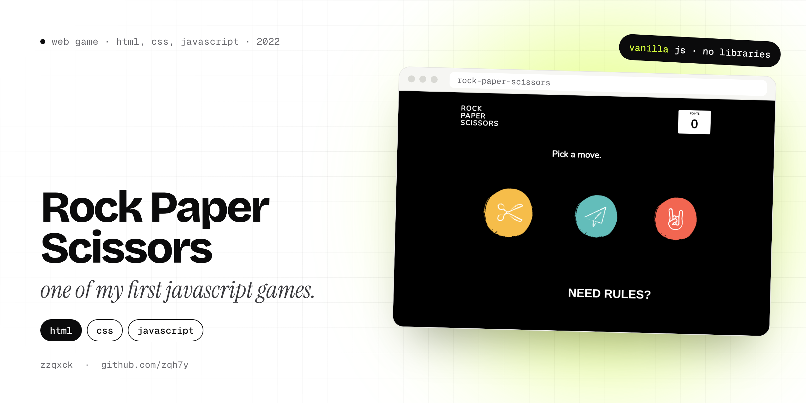
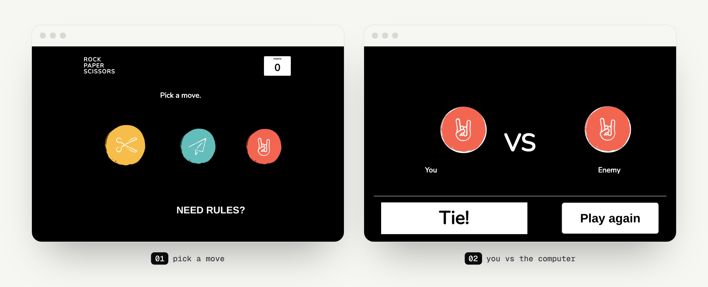

  

  
  
  
  

# Rock Paper Scissors

A rock paper scissors game you play in the browser against the computer. Pick a move, watch it face off against the computer's pick, and keep track of your points. A win gives you a point and a loss takes one away.

It's from December 2022, one of my first JavaScript projects, and it's all about the basics: clicks, timers, showing and hiding parts of the page, and keeping score.

## Screens

  

## How it works

- Three hand-drawn buttons for **rock**, **paper** and **scissors**.
- After you pick, the game switches to a **"You VS Enemy"** screen, the computer picks at random (`Math.random`), and you get **Win!**, **Lose!** or **Tie!**.
- A **points** counter in the corner goes up on a win and down on a loss.
- **Play again** takes you back to the start, and **Need rules?** scrolls to a short how-to-play section.

No frameworks or libraries, just `index.html`, `style.css` and `script.js`, plus the images in `img/`.

## Run it

Download or clone the repo and open `index.html` in any browser. That's it.

---

  Made by <b>zzqxck</b> · <a href="https://zqh7y.github.io/Portfolio/">portfolio</a> · <a href="https://github.com/zqh7y">more projects</a>

